<!-- MathJax -->
<script type="text/javascript" src="https://cdnjs.cloudflare.com/ajax/libs/mathjax/2.7.3/MathJax.js?config=TeX-AMS-MML_HTMLorMML"></script>

# Putting Your Forecast to the Test

In [Demo 3](https://github.com/mesfind/ai_weather/blob/main/docs/_episodes/03-forecast.md) you ran AI models and produced one forecast for one event. In [Demo 4](https://github.com/mesfind/ai_weather/blob/main/docs/_episodes/04-weather-model.md) you benchmarked rainy-season onset and met calibration with IDR for the first time. This demo answers the question a forecaster asks before using any of it operationally: **over years of past forecasts, how good is this model here, in my regions, in my seasons, and for the thresholds my warnings use?**

You will do this with **ForecastCheck**, a local verification framework. Each agency runs its own copy, on its own machine, with its own regions and thresholds. You will work in the use-case track you chose in Demo 3: **Heat** (temperature exceedance; Senegal and Sierra Leone) or **Rainfall** (precipitation exceedance; Kenya and Rwanda). You will fetch your country's data from the cloud, score GraphCast and IFS against observations, calibrate them with IDR, and read the results in a dashboard. Both tracks run the same commands; where they differ, this lesson shows a box for each.

> #### Prerequisites
>
> - An account on the DGX Spark and the SSH tunnel from [Demo 1](https://github.com/mesfind/ai_weather/blob/main/docs/_episodes/01-setup.md). ForecastCheck runs in the Spark's rootless Docker, as in Demos 1–3. You do **not** need a GPU or a Google Cloud account.
> - Your use case from [Demo 3](https://github.com/mesfind/ai_weather/blob/main/docs/_episodes/03-forecast.md): temperature exceedance (what a hot-day threshold is) or precipitation exceedance (what a heavy-rain threshold is), and what a lead time is.
> - The IDR section of [Demo 4](https://github.com/mesfind/ai_weather/blob/main/docs/_episodes/04-weather-model.md) (what calibration can and cannot fix).
{: .prereq}

## Learning Objectives

By the end of this lesson, you will be able to:

- Set up ForecastCheck with Docker and fetch a country's data from the cloud bucket.
- Run the whole pipeline with one command, and find the command behind each stage.
- Explain how IDR is trained and what it produces.
- Read MAE, bias, correlation, CRPS, ROC/AUC, reliability diagrams and cost-loss value curves.
- Use the dashboard to compare models by region, season, altitude band and lead time.
- State what each result depends on before quoting it.

## Lesson Roadmap

| Section | Purpose |
| --- | --- |
| 1. From One Forecast to a Track Record | The question, the two tracks and four countries, what is verified |
| 2. ForecastCheck in One Picture | The three stages and the files that connect them |
| 3. Set Up and Start Everything | One block of commands: the image, your country, the data, the pipeline, the dashboard |
| 4. The Data | What `fetch` brought in, and how to add your own data |
| 5. The Country Settings | Thresholds, seasons, altitude bands and regions |
| 6. Stage 1: Raw Forecast Metrics | What the pipeline does first: MAE, bias and correlation |
| 7. Stage 2: Calibration with IDR | What it does next: how the calibration is trained and applied |
| 8. Stage 3: Calibrated Metrics | What it does last: CRPS, ROC, reliability and cost-loss value |
| 9. The Dashboard | A guided tour, page by page |
| 10. What the Results Say | The Heat track and the Rainfall track, side by side |
| 11. Before You Quote a Number | Limits of the data, and the bridge to Demo 6 |
| Exercises and Discussion Sheet | Hands-on practice in country teams, within your track |

## 1. From One Forecast to a Track Record

A forecast of 41 °C in Matam, or of 40 mm of rain in Kakamega, for next Tuesday is only useful if you know how often this model has been right about days like that. Verification answers that by scoring **many past forecasts** (here, several years of daily forecasts) against **what was observed**.

You will work in country teams, within two tracks. Every team runs the same commands; only the data and the settings differ.

| | **Heat track**: Senegal | **Heat track**: Sierra Leone | **Rainfall track**: Kenya | **Rainfall track**: Rwanda |
| --- | --- | --- | --- | --- |
| Country (`.deployment`) | `senegal` | `sierra-leone` | `kenya` | `rwanda` |
| Bucket folder | `SEN-local-engine` | `SLE-local-engine` | `KMD-local-engine` | `RWA-local-engine` |
| Variables | daily max (`temperature_max`) and min (`temperature_min`) temperature | same | daily rainfall (`precipitation`) | same |
| Models | GraphCast (2016–2026), IFS (2018–2026), no 2023 | same | same | GraphCast (2016–2025), IFS (2018–2025), no 2023 |
| Lead times | days 1, 3, 5, 7 | same | same | same |
| Truth products | CHIRTS (0.05°, observation-based), ERA5 (reanalysis) | same | CHIRPS (satellite and gauges, 0.1° grid) | CHIRPS (0.05°) |
| Test years | 2022 | 2022 | 2022 and 2024 | 2022 and 2024 |
| Regions | 14 regions over 45 departments | 4 provinces over 14 districts | 47 counties | 5 provinces over 30 districts |
| Seasons | NDJF, MAMJ, JASO | ONDJ, FMAM, JJAS | ONDJ (short rains), FMAM (long rains), JJAS | DJF, MAM, JJA, SON |
| Event thresholds | Tmax 37, 38 … 45 °C (nine) | Tmax 37, 38, 39, 40 °C | rain 1, 5, 10 … 60 mm/day (thirteen) | same as Kenya |

Every season list also includes the whole year. Each country has a page in `docs/countries/` with its full settings and the known limits of its data.

> #### Why these variables, and why these truths?
>
> **Heat track.** Neither country has gauge data in ForecastCheck, so both are verified against gridded products. **CHIRTS** is built from station and satellite observations. **ERA5** is a reanalysis: a weather model constrained by observations. They do not agree, and the disagreement is large enough to change conclusions.
>
> **Rainfall track.** Both countries are verified against **CHIRPS**, a satellite rainfall product adjusted with rain gauges, the public truth both share. A national service usually holds better rainfall truth (its own gauges, or a gridded product corrected with them, such as ENACTS) that cannot be published. Section 4.2 shows how to add such data if your trainer gives it to you.
>
> Either way, how far to trust the truth is the subject of [Demo 6](https://github.com/mesfind/ai_weather/blob/main/docs/_episodes/06-ground-truth-challenge.md).
{: .tip}

## 2. ForecastCheck in One Picture

ForecastCheck has three stages. They never call each other: each one writes NetCDF files under `data/`, and the next one finds them there. The dashboard only shows what exists on disk.

```
                 cloud bucket  gs://aim4scale_training_2026/demo5/{SEN|SLE}-local-engine
                      │
                      │  bash docker/run.sh fetch
                      ▼
 data/{country}/forecast/…    raw GraphCast / IFS forecasts
 data/{country}/truth/{product}/…      observations (chirts, era5, chirps)
 data/{country}/assets/dem.nc           elevation, for the altitude bands
                      │
     ┌────────────────┼──────────────────────────────┐
     ▼                ▼                              │
 Stage 1          Stage 2                            │
 verification.run calibration.run (IDR)              │
 raw metrics      train on earlier years, test later │
 MAE, bias,       → data/{country}/idr/…             │
 correlation                │                        │
     │                      ▼                        │
     │               Stage 3                         │
     │               verification.run  --model *-idr │
     │               CRPS, ROC, reliability, cost-loss
     ▼                      ▼                        │
 data/{country}/diagnostics/…   ◄────────────────────┘
                      │
                      ▼
               bash docker/run.sh start   (the dashboard)
```

Two naming rules make the files self-describing:

- A model token without a suffix (`graphcast`, `ifs`) is the **raw** forecast. The suffix `-idr` (`graphcast-idr`) is the **calibrated** one.
- Anything derived from observations carries the name of the truth product it came from (`chirts`, `era5` or `chirps`). A raw forecast does not.

## 3. Set Up and Start Everything

ForecastCheck runs in **Docker**, the way the demos of Demos 1–3 do: one image holds everything (the Python environment, the Google Cloud tools, the map data), and one script, `docker/run.sh`, wraps every command so you never type Docker flags. The Spark's rootless Docker from Demo 1 is all you need; ForecastCheck needs no GPU.

You type **one block of commands**, now. The computation then runs in the background, and Sections 4–8 explain what it is doing, stage by stage, while it works.

Log in to the Spark with a port forward, so the dashboard will reach your laptop. ForecastCheck uses port **8502**, so it does not collide with the course app on 8501:

```bash
ssh -L 8502:localhost:8502 <user>@<spark>
```

Then:

```bash
# 1. Get the code
git clone https://github.com/africlimate-research/forecastcheck.git
cd forecastcheck

# 2. Get the image: build it (about 5 minutes), or load the one your trainer gives you
bash docker/run.sh build              # or: bash docker/run.sh load forecastcheck-image.tar.gz

# 3. Choose your country: senegal, sierra-leone, kenya or rwanda
echo senegal > .deployment

# 4. Fetch your country's data (Section 4 explains what arrives)
export GOOGLE_APPLICATION_CREDENTIALS=/etc/fleet-gcs-key.json
bash docker/run.sh fetch --apply

# 5. Start the whole pipeline: it runs in the background, even if you log out
bash docker/run.sh pipeline

# 6. Start the dashboard; it stays up until you stop it
bash docker/run.sh start
```

Open <http://localhost:8502> on your laptop. The dashboard fills in when the pipeline ends: it restarts by itself, so refresh the browser. To see where the pipeline is, `bash docker/run.sh logs pipeline` (Ctrl-C stops following, not the run).

When you have finished with the dashboard, stop it. Your results stay in `data/`, and `bash docker/run.sh start` brings it back:

```bash
# 7. When you are done: stop the dashboard (data/ is kept)
bash docker/run.sh stop
```


| | Senegal | Sierra Leone | Kenya | Rwanda |
| --- | --- | --- | --- | --- |
| Whole pipeline | about 1.5 h | about 45 min | about 10 min | under 2 min |
| Results on disk | about 19 GB | about 7 GB | about 9 GB | about 1.4 GB |

*Heat-track times measured on a DGX Spark, Rainfall-track times on a 12-core laptop. Most of the disk goes to the calibrated threshold probabilities. If the session is short, your trainer may have run the pipeline for your country in advance; the dashboard then shows the results at once.*

> #### Where you type the commands
>
> Everything above runs in the Spark's terminal, and so do `status`, `logs`, `restart` and `stop`. The `python -m …` commands shown in Sections 6–8 are the ones `pipeline` runs for you. To try one yourself, open a terminal inside ForecastCheck, where they work exactly as shown:
>
> ```bash
> bash docker/run.sh shell              # the prompt changes; type `exit` to leave
> ```
>
> Or run a single one from the Spark's terminal: `bash docker/run.sh run python -m verification.run …`. Everything reads and writes the same `data/` folder. `bash docker/run.sh help` lists every command.
{: .tip}

> #### Which country am I?
>
> The one-line file `.deployment` decides: `senegal`, `sierra-leone`, `kenya` or `rwanda`. Every team runs the same code from the same `main`; the country file it names (for example `deployments/kenya.toml`) sets the map, the regions, the seasons and where the data comes from. `.deployment` is not in git, so `git pull` never changes it. There is nothing else to set. If you change it, run `bash docker/run.sh restart` so the dashboard follows.
{: .tip}

> #### Without Docker
>
> On a machine without Docker, use conda instead: `conda env create -f environment.yml` and `conda activate forecastcheck`, then drop `bash docker/run.sh` from the commands (`./scripts/fetch_country.sh`, `./scripts/run_pipeline.sh`, and `streamlit run ui/app.py` for the dashboard, on port 8501). The repository's README has the details.
{: .tip}

## 4. The Data

### 4.1 What is in the bucket

Each country has one folder in the bucket. The forecasts and the truth have already been put on the same grid, so ForecastCheck only has to match dates. A Heat-track folder looks like this:

```
gs://aim4scale_training_2026/demo5/SEN-local-engine/
├── raw/gridded/temperature_2m_max/{year}/{graphcast|ifs|…}/{24,72,120,168,216}h.nc forecasts
├── raw/gridded/temperature_2m_min/…
├── target/gridded/temperature_2m_max/{CHIRTS|ERA5}/{year}.nc                       truth
├── target/gridded/temperature_2m_min/…
└── assets/dem.nc                                                                   elevation
```

A file such as `raw/gridded/temperature_2m_max/2022/graphcast/72h.nc` holds every GraphCast forecast started in 2022, read at a lead time of 72 hours (day 3), for every grid cell in the country.

A Rainfall-track folder has the same shape with one variable, `precipitation`, and one truth, `CHIRPS`:

```
gs://aim4scale_training_2026/demo5/KMD-local-engine/
├── raw/gridded/precipitation/{year}/{graphcast|ifs}/{24,72,120,168,216}h.nc   forecasts
├── target/gridded/precipitation/CHIRPS/{year}.nc                              truth
└── assets/dem.nc                                                              elevation
```

Rainfall in the forecast files is in **mm/hr** (the day's total divided by 24); the truth is in **mm/day**. ForecastCheck converts for you. Each value is the rain for one day, 06 UTC to 06 UTC, the same window as the observations.

### 4.2 How `fetch` works

The bucket is read-only and private to the training. On the DGX Spark a key that can read it is already installed; the `export` line of Section 3 tells the Google Cloud tools where it is, **by its path**:

```bash
export GOOGLE_APPLICATION_CREDENTIALS=/etc/fleet-gcs-key.json
```

Never open the key, paste its contents into a file or a chat, or copy it elsewhere: the path is all anyone needs. The variable lasts for the current terminal; set it again in a new one.

`bash docker/run.sh fetch` knows your country from `.deployment` and where its data lives from the country file. It downloads the GraphCast and IFS forecasts, every truth product in your country's folder (CHIRTS and ERA5 for Heat, CHIRPS for Rainfall) and the elevation map, and lays the files out the way ForecastCheck expects. Without `--apply` it only lists what it would fetch: a good habit before a large download.

```bash
bash docker/run.sh fetch              # dry run: lists what would be fetched
bash docker/run.sh fetch --apply      # downloads
```

Every team runs the same commands. What Section 3's fetch brought in:

| | Senegal | Sierra Leone | Kenya | Rwanda |
| --- | --- | --- | --- | --- |
| Download (forecasts, truth, elevation) | about 3.5 GB | about 1.7 GB | about 1.0 GB | about 0.2 GB |
| Files | 235 | 235 | 106 | 96 |

Re-running is safe: it copies only what is missing or changed, and never leaves a half-written file behind, so an interrupted download simply resumes.

> #### If the fetch stops
>
> - *"the data bucket needs a Google Cloud key"*: the key is not set in this terminal. Run the `export` line above, then the command again.
> - *"cannot read gs://…"*: the key is set but cannot read the bucket. Check the path in the `export` line. (The script also sets `CLOUDSDK_AUTH_CREDENTIAL_FILE_OVERRIDE` to the same path, which some setups need.)
> - No network, or a slow one? Your trainer can give you a copy of the country folder (for example on a shared disk). Point the script at it; nothing is downloaded and the result is identical:
>
> ```bash
> bash docker/run.sh fetch --from /path/to/SEN-local-engine --apply
> ```
{: .warning}

> #### Adding your own national data
>
> Your trainer may give you national data that cannot be published, for example rain-gauge records or a gridded product corrected with gauges, on a flash disk. It comes as a folder laid out like the bucket's. Add it with the same command; the folder is only read, never changed, and the data is placed next to what you already fetched, so every later step includes it:
>
> ```bash
> bash docker/run.sh fetch --from /media/$USER/<flash-disk>/<folder>          # dry run
> bash docker/run.sh fetch --from /media/$USER/<flash-disk>/<folder> --apply
> ```
>
> It stays on this machine: `data/` is never committed, and results computed from it are not shared outside the class.
{: .tip}

### 4.3 Check it landed

```bash
ls data/senegal/truth data/senegal/assets
```

Expect `dem.nc` under `assets`, and under `truth`: `chirts` and `era5` for the Heat track, `chirps` for the Rainfall track. Use your country's folder: `data/sierra_leone/…`, `data/kenya/…`, `data/rwanda/…`.

## 5. The Country Settings

Everything a forecaster is likely to change lives in one file, `config/verification.toml`. No Python.

```toml
[Senegal.thresholds]
temperature_max = [37, 38, 39, 40, 41, 42, 43, 44, 45]   # °C, one "hot day" event per value
temperature_min = []                                      # no threshold events for Tmin

[Senegal.altitude_bands]
"0-25"  = [0, 25]          # metres
">100"  = [100, "inf"]

[Senegal.seasons.ndjf]
months = [11, 12, 1, 2]
label  = "NDJF (Nov–Feb)"
```

A Rainfall-track country has the same sections, with rain thresholds in mm/day:

```toml
[Kenya.thresholds]
precipitation = [1, 5, 10, 15, 20, 25, 30, 35, 40, 45, 50, 55, 60]   # mm/day

[Kenya.seasons.fmam]
months = [2, 3, 4, 5]
label  = "FMAM (Feb–May)"        # long rains
```

- A **threshold** defines an event ("Tmax > 40 °C", "rain > 20 mm/day"). Every threshold produces its own ROC, reliability and cost-loss curves in Stage 3. For rainfall, 1 mm/day separates a wet day from a dry one.
- A **season** is a set of months. Seasons, regions and departments all come out of the same run.
- An **altitude band** groups grid cells by elevation from `dem.nc`.

> #### Changing a setting means re-running
>
> Change `thresholds` and you must re-run Stage 2 and Stage 3. Change `seasons` and you must re-run Stage 3. A mistake in the file stops the run with a message naming the country and the key; it never silently falls back to a default.
{: .warning}

## 6. Stage 1: Raw Forecast Metrics

### 6.1 How a forecast is matched to an observation

A forecast started on 1 March at lead day 3 is **valid** on 4 March. It is compared with the observation for 4 March, in the same grid cell. Every (forecast, observation) pair for one lead time, one model and one year is scored, then averaged over grid cells and days, per month, per region and per altitude band.

### 6.2 The metrics

For $N$ pairs of forecast $f_i$ and observation $o_i$:

| Metric | Formula | Units | Perfect | Question it answers |
| --- | --- | --- | --- | --- |
| **MAE** (mean absolute error) | $\frac{1}{N}\sum_i \lvert f_i - o_i \rvert$ | °C or mm | 0 | How far off is a typical forecast? |
| **Bias** (mean error) | $\frac{1}{N}\sum_i (f_i - o_i)$ | °C or mm | 0 | Is the model systematically too warm / too wet (+), or too cold / too dry (−)? |
| **Pearson correlation** | $\frac{\mathrm{cov}(f,o)}{\sigma_f\,\sigma_o}$ | none | 1 | Does the forecast go up and down with the observations? |
| **Spearman correlation** | Pearson correlation of the ranks of $f$ and $o$ | none | 1 | Same, but insensitive to outliers and to non-linear relations |

> #### Read them together
>
> MAE mixes two things: a constant offset (bias) and day-to-day errors. A model with a bias of +2 °C and a high correlation is easy to fix with calibration. A model with no bias and a low correlation is not. That is why we look at bias and correlation before we calibrate.
{: .tip}

> #### Rainfall track: the dashboard shows rainfall in mm/hr
>
> Rainfall scores (MAE, bias, CRPS) are stored and plotted in **mm/hr**: a daily total divided by 24. Multiply by 24 before you quote one: 0.04 mm/hr is about 1 mm/day. Thresholds are always in **mm/day**.
{: .warning}

### 6.3 Under the hood

This is the first thing `pipeline` does. Each result lands in a file whose path names the model, the variable, the truth product, the metric, the year and the lead time.

<details>
<summary><strong>The commands it runs, and what they print</strong></summary>
<br>

**Heat track:**

```bash
python -m verification.run --model graphcast ifs --variable temperature_max --metric mae bias pearsonr spearmanr --lead-day 1 3 5 7 --year 2022 --product chirts
python -m verification.run --model graphcast ifs --variable temperature_min --metric mae bias pearsonr spearmanr --lead-day 1 3 5 7 --year 2022 --product chirts
```

**Rainfall track** (both test years in one command):

```bash
python -m verification.run --model graphcast ifs --variable precipitation --metric mae bias pearsonr spearmanr --lead-day 1 3 5 7 --year 2022 2024 --product chirps
```

| Flag | Meaning |
| --- | --- |
| `--model graphcast ifs` | Raw forecasts of both models |
| `--variable` | `temperature_max` / `temperature_min` (Heat) or `precipitation` (Rainfall). Heat teams must give it: the default is precipitation |
| `--lead-day 1 3 5 7` | Lead times to score |
| `--year 2022` | The verification year; several are allowed (`--year 2020 2021 2022`) |
| `--product` | Which truth to score against: `chirts` or `era5` (Heat; required, there are two), `chirps` (Rainfall) |

Each command takes 1–3 minutes. For every model and lead time it prints one line, then the files it wrote:

```text
graphcast | lead 1d (24h) | temperature_max | gridded 2022
  wrote data/senegal/diagnostics/graphcast/temperature_max/chirts/gridded/mae/2022/annual_monthly_averages/24h.nc
  wrote data/senegal/diagnostics/graphcast/temperature_max/chirts/gridded/bias/2022/annual_monthly_averages/24h.nc
  …
```

</details>

> #### Two kinds of correlation
>
> The **map** of correlation shows, for each grid cell, how well the day-to-day ups and downs of the forecast follow the observations over the year. The **single national number** is different: for each day it measures how well the forecast *map* matches the observed *map* (a pattern correlation), then averages over the days. Both are useful, but they answer different questions. Say which one you quote.
{: .warning}

## 7. Stage 2: Calibration with IDR

### 7.1 The idea

A raw forecast says "Tmax will be 39 °C". Past data tells us how often, when this model said 39 °C in this grid cell, the observation was 37, 39 or 42 °C. **Isotonic Distributional Regression (IDR)** learns that relationship and turns every new forecast value into a full **probability distribution** for the observation.


*Figure 1. IDR on one real grid cell near Matam (GraphCast, day 1, against CHIRTS). On the left, every grey dot is a past day: what GraphCast said (x) and what was observed (y). Almost all dots lie above the dashed line, so GraphCast is too cold here. IDR learns the blue staircase: for each forecast value, the median and spread of what was then observed. On the right, the same mapping applied to forecasts in 2022, a year it never saw: the raw forecast (orange) is about 3.2 °C too cold, the calibrated median (blue) is off by about 0.7 °C.*

IDR makes one assumption only: **a higher forecast should never mean a colder outcome.** Mathematically, the predicted distribution must shift upward (or stay put) as the forecast increases. It does not assume a bell curve or any other shape. The fit is done with the pool-adjacent-violators algorithm.

> #### Rainfall track: most days are dry
>
> In Kenya fewer than one cell-day in five gets more than 1 mm; in Rwanda about one in three. So for a typical forecast, IDR's distribution starts with a **spike at 0 mm** (the chance of a dry day) followed by a long tail of wet days. That is why rainfall probabilities for heavy-rain thresholds are usually small, and why the 1 mm/day threshold is a "will it rain at all?" question rather than a heavy-rain one. IDR handles this without any special treatment: it never assumes a shape.
{: .tip}

### 7.2 How it is trained here

| Choice | In ForecastCheck | Why |
| --- | --- | --- |
| One fit per… | grid cell, lead time, model and truth product | Errors depend on place (coast vs. inland) and grow with lead time |
| Predictor | the raw forecast value only | Simple, monotone, needs no extra data |
| Training years | Heat: GraphCast 2016–2021, IFS 2018–2021. Rainfall: 2018–2021 for the 2022 test, 2018–2022 for the 2024 test | IFS data starts in 2018 |
| Test years | Heat: 2022. Rainfall: 2022 and 2024 (2023 is missing for IFS) | **Never** in the training years, otherwise the skill is overstated |
| Seasons | not separated in the fit | One fit uses all days of the training years |

### 7.3 What it produces

For each day of the test year, each grid cell and each lead time, `calibration.run` writes to `data/{country}/idr/{product}/…`:

| Output | Meaning |
| --- | --- |
| `q5`, `q50`, `q95`, `q99` | Quantiles of the calibrated distribution (°C, or mm/hr for rainfall). `q50` is the calibrated "best guess". |
| `p_exceed` | Probability that the observation exceeds each threshold in the settings (37 °C, 38 °C, …; or 1, 5, … 60 mm/day) |
| `crps` | The score of the whole distribution against the observation (see Section 8) |
| `pit` | Where the observation fell in the distribution (0 to 1); used to check calibration |

### 7.4 Under the hood

<details>
<summary><strong>The commands <code>pipeline</code> runs for this stage</strong></summary>
<br>

```bash
python -m calibration.run --variable temperature_max --model graphcast --leads 1,3,5,7 --train-years 2016,2017,2018,2019,2020,2021 --test-year 2022 --product chirts
python -m calibration.run --variable temperature_max --model ifs --leads 1,3,5,7 --train-years 2018,2019,2020,2021 --test-year 2022 --product chirts
python -m calibration.run --variable temperature_min --model graphcast --leads 1,3,5,7 --train-years 2016,2017,2018,2019,2020,2021 --test-year 2022 --product chirts
python -m calibration.run --variable temperature_min --model ifs --leads 1,3,5,7 --train-years 2018,2019,2020,2021 --test-year 2022 --product chirts
```

The Rainfall track trains once per test year:

```bash
for m in graphcast ifs; do
  python -m calibration.run --variable precipitation --model $m --leads 1,3,5,7 --train-years 2018,2019,2020,2021 --test-year 2022 --product chirps
  python -m calibration.run --variable precipitation --model $m --leads 1,3,5,7 --train-years 2018,2019,2020,2021,2022 --test-year 2024 --product chirps
done
```

For each lead it prints how many grid cells received a calibrated forecast:

```text
  lead 1d (24h) -> data/senegal/idr/chirts/gridded/temperature_max/2022/graphcast/24h.nc  (calibrated cells: 15476)
```

</details>

Calibration is the slow stage, because it fits one model per grid cell: about 15,000 in Senegal, 7,000 in Sierra Leone, 11,000 in Kenya, 1,700 in Rwanda. That is most of the pipeline's time in the table of Section 3.

The calibrated files are large, mostly because of the threshold probabilities (`p_exceed`): Senegal has nine thresholds, the Rainfall countries thirteen.

> #### Optional: watch one calibration live
>
> Your pipeline does the full calibration for you. To see IDR fit with your own eyes, run one small slice in `bash docker/run.sh shell`, **once `bash docker/run.sh status` says the pipeline is not running**: both would write the same files. Heat track:
>
> ```bash
> python -m calibration.run --variable temperature_max --model graphcast --leads 1,3 --train-years 2016,2017,2018,2019,2020,2021 --test-year 2022 --product chirts
> ```
>
> Rainfall track:
>
> ```bash
> python -m calibration.run --variable precipitation --model graphcast --leads 1,3 --train-years 2018,2019,2020,2021 --test-year 2022 --product chirps
> ```
>
> It takes a few minutes (Heat about 5–10, Rainfall less). Use the time for Exercise 3.
{: .tip}

> #### What IDR can and cannot do (recap from Demo 4)
>
> IDR removes bias and fixes over- and under-confidence. It cannot create skill the raw forecast does not have: if the raw forecast does not move with the observations (low correlation), the calibrated distribution will just be wide.
{: .tip}

## 8. Stage 3: Calibrated Metrics

This is the last thing `pipeline` does: it scores the calibrated forecasts of Stage 2. When it ends, the dashboard restarts by itself.

<details>
<summary><strong>The commands it runs</strong></summary>
<br>

```bash
python -m verification.run --model graphcast-idr ifs-idr --variable temperature_max --metric crps roc reliability cost_loss --lead-day 1 3 5 7 --year 2022 --product chirts
python -m verification.run --model graphcast-idr ifs-idr --variable temperature_min --metric crps roc reliability cost_loss --lead-day 1 3 5 7 --year 2022 --product chirts
```

`temperature_min` has no thresholds, so for it the run prints a note and computes CRPS only. Then repeat Stages 1–3 with `--product era5`. Rainfall track:

```bash
python -m verification.run --model graphcast-idr ifs-idr --variable precipitation --metric crps roc reliability cost_loss --lead-day 1 3 5 7 --year 2022 2024 --product chirps
```

</details>

### 8.1 CRPS: the score of a whole distribution

The **Continuous Ranked Probability Score** compares the predicted cumulative distribution $F$ with the observation $o$:

$$\mathrm{CRPS}(F, o) = \int_{-\infty}^{\infty} \big(F(x) - \mathbb{1}\{x \ge o\}\big)^2 \, dx$$

- It is in the variable's units (°C, or mm/hr for rainfall), and lower is better.
- For a single-value forecast, $F$ is a step at $f$ and the CRPS **equals the absolute error** $\lvert f - o \rvert$. So the raw MAE and the calibrated CRPS sit on the same axis, and the dashboard compares them directly. If CRPS(IDR) < MAE(raw), calibration helped.

### 8.2 Events and probabilities

For each threshold $t$ (for example 40 °C, or 20 mm/day) an **event** is a day where the observation exceeds $t$. The calibrated forecast gives a probability $p$ for that event. To turn $p$ into a yes/no warning, choose a cut-off $p^*$ and warn when $p \ge p^*$. Each cut-off gives a contingency table:

| | Event observed | Not observed |
| --- | --- | --- |
| **Warned** | Hit (H) | False alarm (FA) |
| **Not warned** | Miss (M) | Correct negative (CN) |

### 8.3 ROC curve and AUC: can the model tell event days from other days?

For 500 cut-offs between 0.01 and 1, ForecastCheck plots the hit rate $\mathrm{TPR} = H/(H+M)$ against the false-alarm rate $\mathrm{FPR} = FA/(FA+CN)$. The area under that curve (**AUC**) is 0.5 for a coin toss and 1 for a perfect model. AUC measures **discrimination**, and calibration barely changes it.

### 8.4 Reliability diagram: can I trust the probability?

Forecast probabilities are put into 10 bins. For each bin, the diagram plots the mean forecast probability (x) against how often the event actually happened (y). On a reliable forecast the points lie on the diagonal: when it says 30 %, it happens 30 % of the time.

- **Below the diagonal**: the event happens less often than forecast. The forecast is too sure of the event (over-forecasting).
- **Above the diagonal**: the event happens more often than forecast (under-forecasting).
- **Error bars**: a 95 % range from 50 bootstrap resamples of whole days. A point whose bar crosses the diagonal is not clearly unreliable.

The bins are not equally wide. After calibration, most days get a probability very close to 0 (a cool day is clearly not a 40 °C day, a dry-looking day clearly not a 20 mm day), so ForecastCheck keeps one bin for those near-zero probabilities and splits the rest so that each bin holds the same number of forecasts. That is why the points are not evenly spaced along the x-axis.

### 8.5 Cost-loss value: is it worth acting on?

A user who protects against a hot day, or a heavy-rain day, pays a cost $C$; if they do not protect and the event happens, they lose $L$. Their cost-loss ratio is $\alpha = C/L$. With $s$ the base rate (how often the event happens) and $n$ the number of cases:

$$E_{\text{clim}} = \min(\alpha, s), \qquad E_{\text{perfect}} = \alpha s, \qquad E_{\text{forecast}} = \alpha\,\frac{H + FA}{n} + \frac{M}{n}$$

$$V(\alpha) = \frac{E_{\text{clim}} - E_{\text{forecast}}}{E_{\text{clim}} - E_{\text{perfect}}}$$

ForecastCheck picks, for each $\alpha$, the cut-off $p^*$ that gives the best value. $V = 1$ is as good as a perfect forecast, $V = 0$ is no better than always or never acting based on climatology, and $V < 0$ means the forecast costs money.

> #### Read the event count first
>
> Under every curve the dashboard shows how many events are behind it. A curve built on a few hundred events can look excellent by chance. AUC in particular is blind to how rare an event is.
{: .warning}

## 9. The Dashboard

The dashboard has been running since Section 3 (`bash docker/run.sh start`). Open <http://localhost:8502> on your laptop; the SSH tunnel from Section 3 forwards it. It discovers results when it starts: after `bash docker/run.sh pipeline` it restarts by itself, and after commands you ran yourself, run `bash docker/run.sh restart` and refresh the browser.

The tour below uses the Heat track's screenshots (Senegal). Every country sees the same pages with its own regions and thresholds; Section 9.7 shows what is different in the Rainfall track.

### 9.1 Choosing where: the region picker

Every page starts with the same picker. The top row is the whole country and its first-level areas (Senegal's 14 regions, Sierra Leone's 4 provinces, Kenya's 47 counties, Rwanda's 5 provinces). **More regions** opens a search box for the second level, where there is one (Senegal's 45 departments, Sierra Leone's 14 districts, Rwanda's 30 districts). Everything below the picker is recomputed for the area you select.

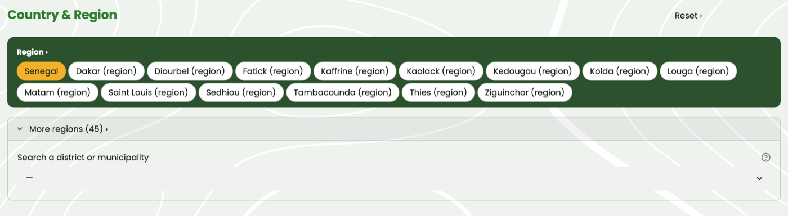

### 9.2 Every page has a configuration panel

On the left of each chart, the **Configuration** panel has three blocks:

| Block | What you choose |
| --- | --- |
| Forecast & Truth | Variable (Tmax, Tmin or Rainfall), models, truth product (CHIRTS, ERA5 or CHIRPS) |
| Score | The metric |
| Conditioning | Year, season, lead time, altitude band |

The menus only offer combinations that exist on disk. If a model or a metric is missing, the pipeline did not produce it (see Troubleshooting).

### 9.3 National Overview: raw forecast metrics

Open **National Overview** and select the **Raw Forecast Metrics** tab. This is Stage 1.

- **Graph View** plots a metric against lead time or month, one line per model.
- **Country View** maps it, grid cell by grid cell, for one model and one lead time.

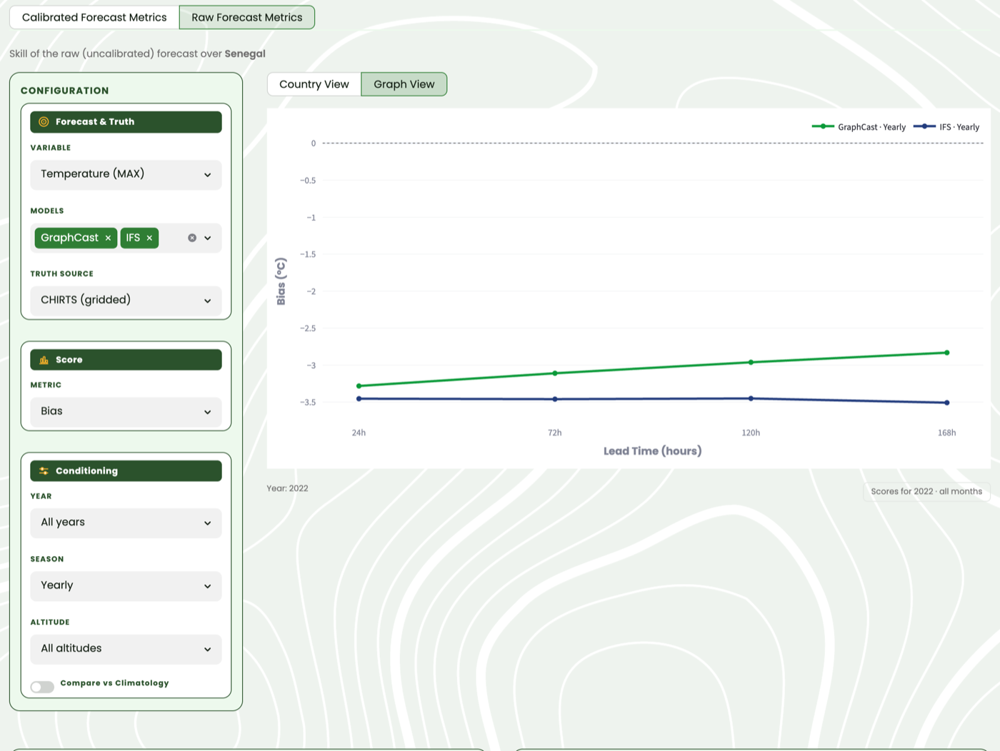

*Figure 2. Bias of the raw Tmax forecasts against CHIRTS, Senegal 2022. Both models are about 3 °C too cold at every lead time. IFS (blue) is the colder of the two.*

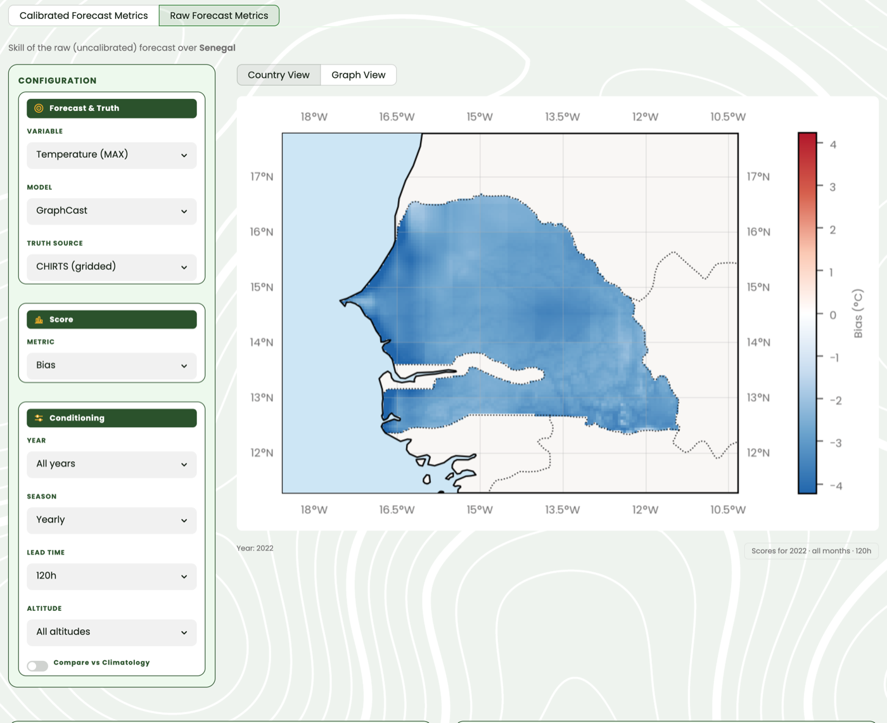

*Figure 3. The same bias as a map (GraphCast, day 5). It is negative everywhere, slightly stronger on the coast. A bias that is this uniform is exactly what calibration can remove.*

### 9.4 National Overview: calibrated forecast metrics

The **Calibrated Forecast Metrics** tab shows the CRPS of the `-idr` forecasts (Stage 3). The **Month** view shows when in the year the calibrated forecast struggles.

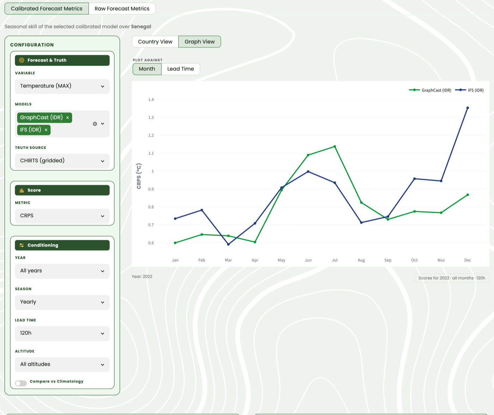

*Figure 4. CRPS of calibrated GraphCast and IFS by month, day 5. The errors are largest in June–July for GraphCast, and in October–December for IFS. A likely reason for the summer peak is the arrival of the monsoon, when day-to-day cloudiness makes Tmax harder to predict. Exercise 5 asks you to check this by season.*

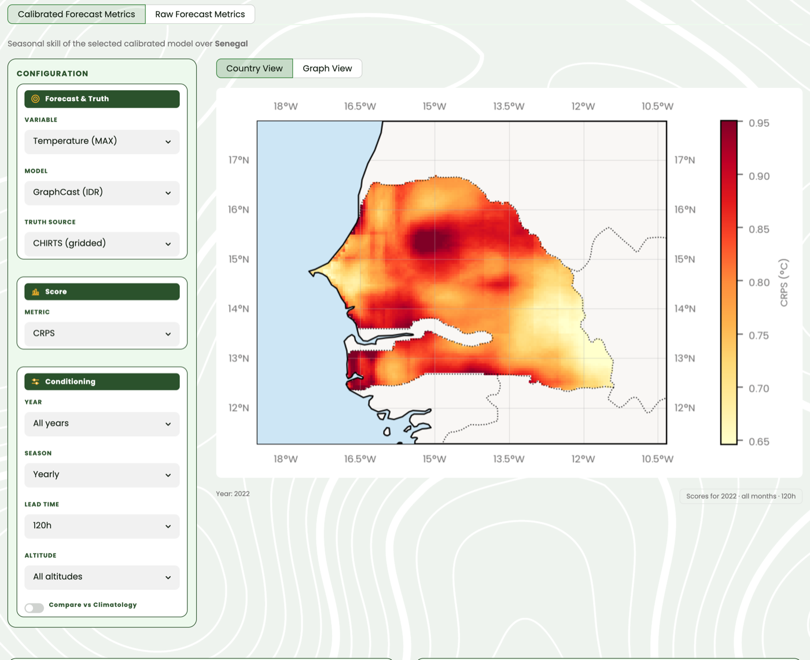

*Figure 5. CRPS of calibrated GraphCast, day 5. After calibration the remaining error is below 1 °C almost everywhere, and largest in the centre-north.*

### 9.5 Score Decomposition: did calibration help?

**Score Decomposition → Miscalibration** plots, for each model, $\mathrm{CRPS}_{\text{IDR}} - \mathrm{MAE}_{\text{raw}}$: the error removed by calibration. **Below zero means calibration helped.** With one model selected, you can compare both truth products on the same chart.

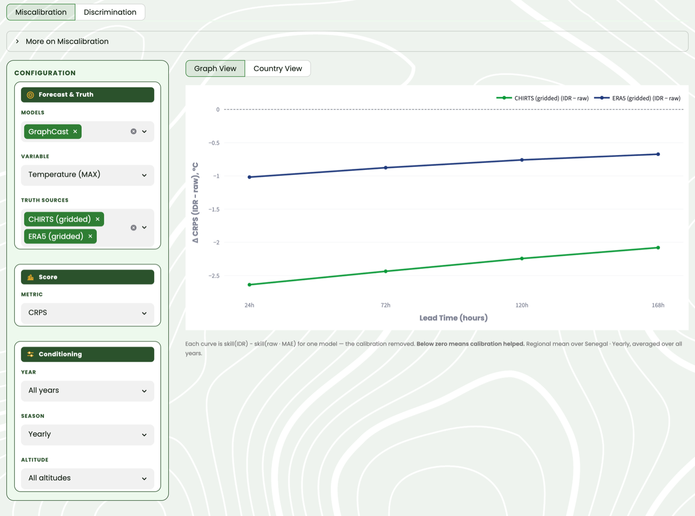

*Figure 6. Calibration removes about 2.5 °C of GraphCast's error against CHIRTS, but only about 1 °C against ERA5. The model and the forecasts are the same; only the truth changed. Keep this figure in mind for Demo 6.*

### 9.6 Threshold Diagnostics: hot-day warnings

**Threshold Diagnostics** has three tabs, one per curve from Section 8, for one threshold, lead time, season and altitude band at a time. Under every chart, the **sample box** gives the number of events, the number of forecasts evaluated and the event's share.

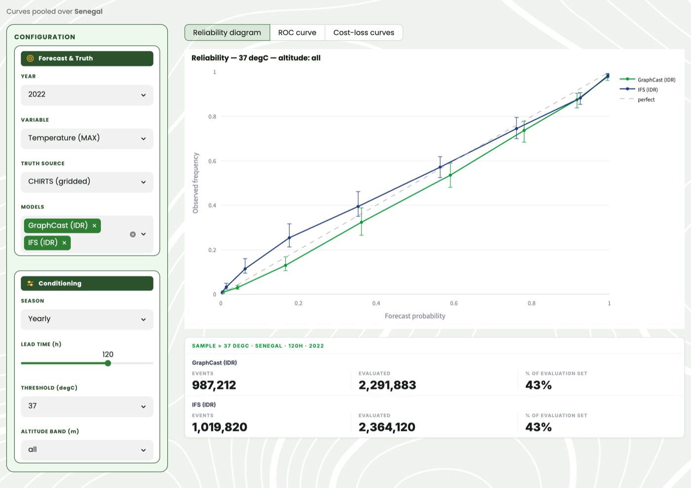

*Figure 7. Reliability for Tmax > 37 °C at day 5. Both calibrated models are close to the diagonal. GraphCast sits slightly below it (a little over-forecasting), IFS slightly above. 37 °C is common in Senegal (43 % of cell-days), so the curve rests on almost a million events.*

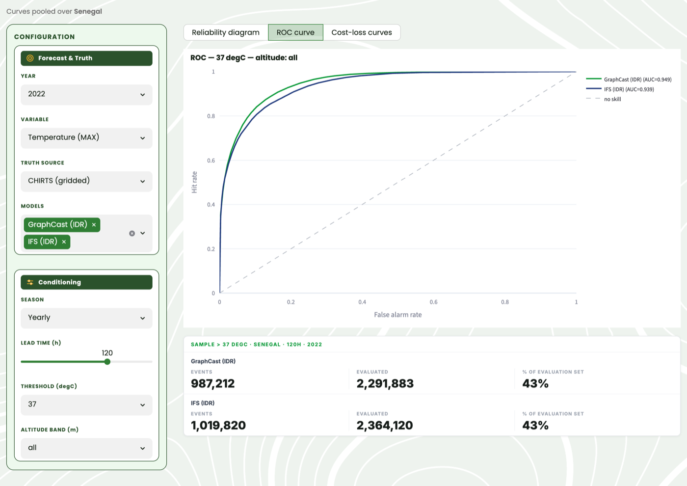

*Figure 8. ROC for the same event. Both curves hug the top-left corner: AUC 0.95 for GraphCast and 0.94 for IFS at day 5.*

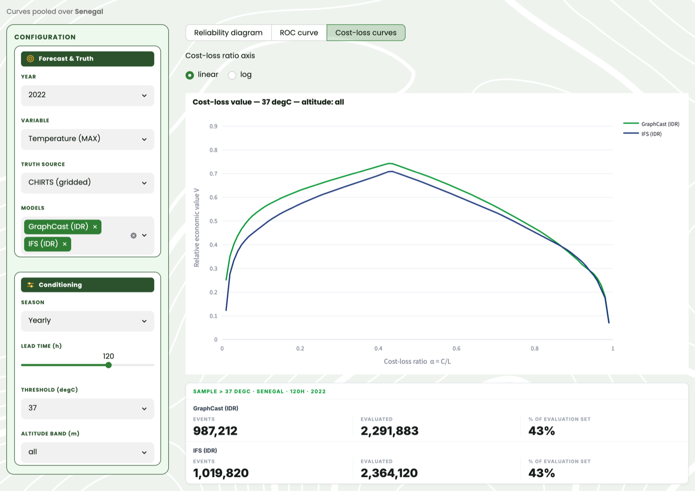

*Figure 9. Value for the same event. The forecast is worth acting on for almost every user, and most valuable to users whose cost-loss ratio is close to the event's frequency (about 0.43 here), where climatology alone gives no guidance.*

### 9.7 The Rainfall track in the dashboard

The pages and panels are the same. Choose **Rainfall** as the variable and **CHIRPS** as the truth. Remember that the rainfall scores are in **mm/hr** (multiply by 24 for mm/day), and that the default threshold on Threshold Diagnostics is 20 mm/day, a heavy-rain day.

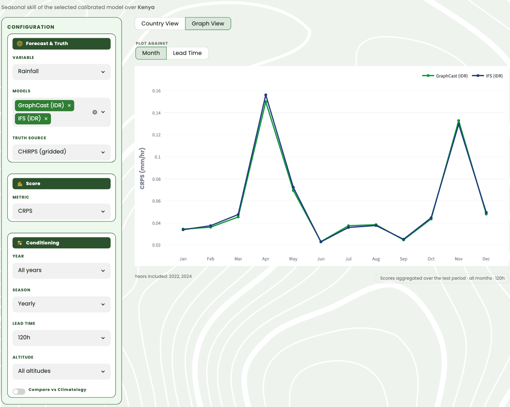

*Figure R1. CRPS of calibrated GraphCast and IFS rainfall by month, Kenya, day 5, 2022 and 2024 together. The error follows the rain: two peaks, in April (long rains, about 0.15 mm/hr, 3.6 mm/day) and November (short rains, about 0.13 mm/hr), and almost nothing in the dry months (about 0.02 mm/hr in June). A dry month is easy to forecast; read the scores season by season.*

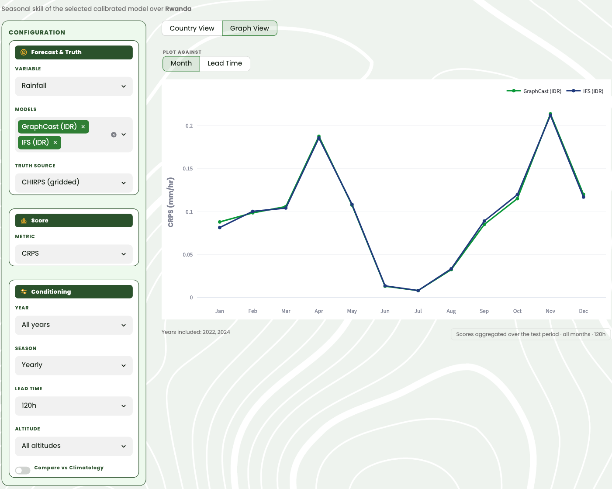

*Figure R2. The same chart for Rwanda: its four seasons are visible, peaks in April (MAM, long rains) and November (SON, short rains), and near zero in June–July (JJA, the long dry season).*

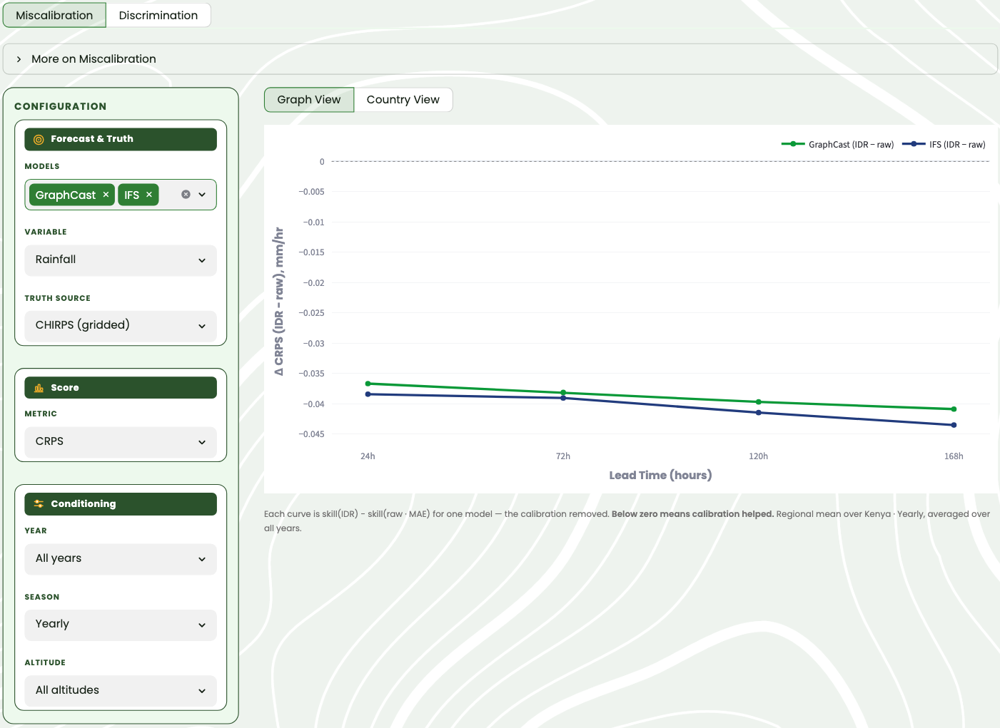

*Figure R3. Error removed by calibration in Kenya: about 0.037–0.041 mm/hr for GraphCast and 0.039–0.044 mm/hr for IFS, roughly 1 mm/day, slightly more at longer lead times. With only one public truth, this chart compares the two models rather than two truths.*

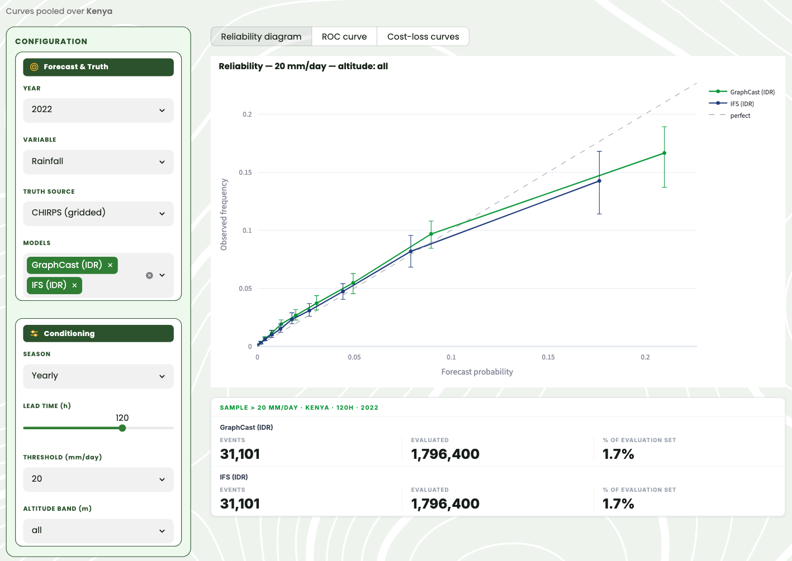

*Figure R4. Reliability for rain > 20 mm/day at day 5, Kenya 2022. Both calibrated models sit close to the diagonal: when they say 10 %, it rains more than 20 mm about 10 % of the time. But they almost never say more than 20 %. The forecast is honest about heavy rain, but rarely confident. Heavy-rain days are 1.7 % of cell-days here.*

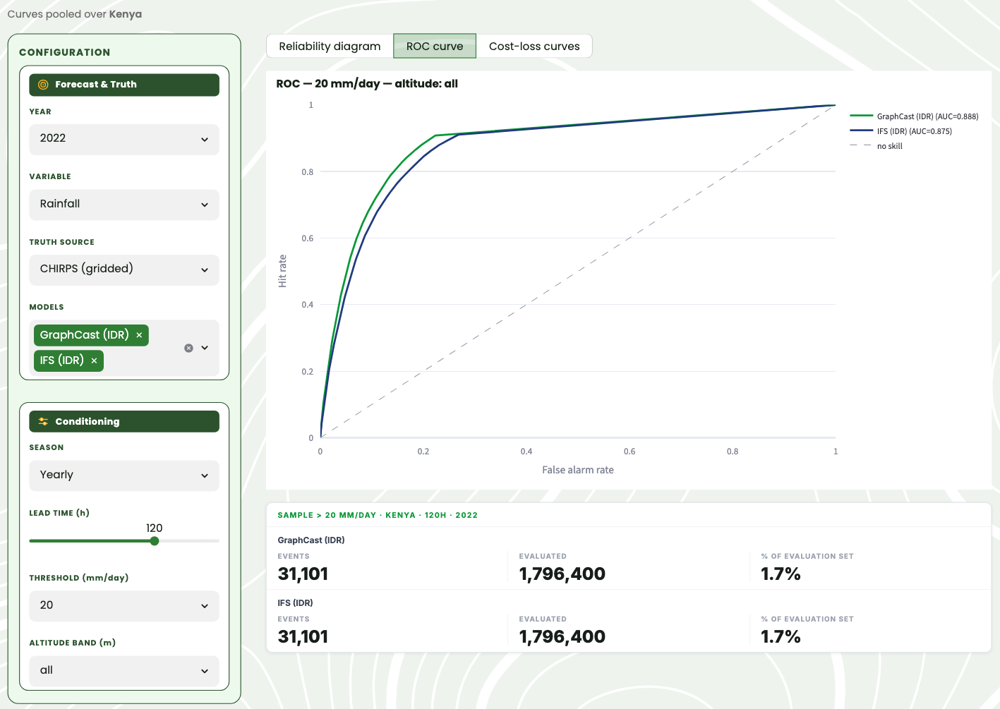

*Figure R5. ROC for the same event: AUC 0.89 for GraphCast and 0.88 for IFS. Look at the top of the curve: above a hit rate of about 0.9 it is a straight line. On most days the calibrated probability of 20 mm is close to 0, and the forecast cannot rank those days against each other; the straight segment is where they all sit.*

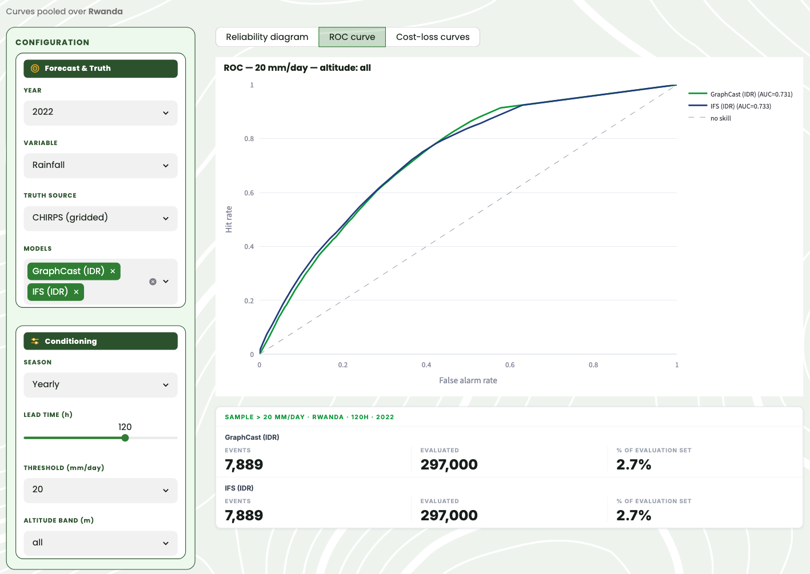

*Figure R6. The same event in Rwanda: AUC 0.73 for both models, much lower than in Kenya. The forecast maps barely match the observed ones there (pattern correlation 0.15, Section 10.3). A likely reason: Rwanda is small and hilly, and much of its daily rain comes from local storms that a 0.25° model places poorly.*


## 10. What the Results Say

These are the reference results, computed with exactly the commands in this lesson. Use them to check your own run, and as the starting point for the discussion sheet. All numbers are national averages: for the Heat track, daily maximum temperature (Tmax) against CHIRTS in 2022 unless stated otherwise; for the Rainfall track, daily rainfall against CHIRPS.

### 10.1 Heat track: side by side

| Day 1 (24 h) | Senegal GraphCast | Senegal IFS | Sierra Leone GraphCast | Sierra Leone IFS |
| --- | --- | --- | --- | --- |
| Raw MAE | 3.20 °C | 3.42 °C | 4.39 °C | 4.40 °C |
| Raw bias | −3.17 °C | −3.38 °C | −4.37 °C | −4.38 °C |
| Pattern correlation | 0.89 | 0.86 | 0.60 | 0.56 |
| Calibrated CRPS | **0.66 °C** | 0.74 °C | **0.66 °C** | 0.71 °C |
| AUC, Tmax > 40 °C | 0.98 | 0.98 | 0.98 | 0.96 |
| Events > 40 °C in 2022 | 393,650 | 410,884 | 4,325 | 4,337 |

| Day 7 (168 h) | Senegal GraphCast | Senegal IFS | Sierra Leone GraphCast | Sierra Leone IFS |
| --- | --- | --- | --- | --- |
| Raw MAE | 2.90 °C | 3.55 °C | 4.35 °C | 4.40 °C |
| Calibrated CRPS | 0.88 °C | 0.91 °C | 0.78 °C | 0.81 °C |
| AUC, Tmax > 40 °C | 0.97 | 0.97 | 0.97 | 0.98 |

*Event counts are cell-days: one grid cell on one day. The two models have slightly different counts because each is scored only on days and cells where it has a forecast.*

### 10.2 Heat track: five findings

1. **Both models are much too cold against CHIRTS, everywhere.** About −3 °C in Senegal and −4.4 °C in Sierra Leone, almost the same at every lead time and in every grid cell (Figures 3 and 10). Most of the raw MAE is this bias.

2. **Calibration removes almost all of it.** After IDR the error is about 0.7 °C at day 1 in both countries, from very different starting points. In Sierra Leone, IDR removes about 3.7 °C of error against CHIRTS (Figure 11).

3. **For Tmax, after calibration, GraphCast is slightly better than IFS at every lead time,** by 0.03–0.09 °C of CRPS. This difference is small compared with the effect of calibration or of the truth product, and it does not hold for every variable: for Tmin in Senegal, calibrated IFS is better from day 5 on.

4. **Sierra Leone's maps are harder to get right.** The pattern correlation is 0.60 there, against 0.89 in Senegal. A likely reason: Sierra Leone is small and its temperature varies less from place to place, so the daily pattern is made of small details that a 0.25° model resolves poorly.

5. **The rarest thresholds need care.** In Sierra Leone, 40 °C happens on 0.5 % of cell-days against CHIRTS, and on 77 cell-days in the whole year against ERA5 (Figure 12). ERA5 almost never reaches 40 °C there, so the curve has nothing to learn from: AUC is exactly 0.5 and the value is 0. That threshold must be read against CHIRTS, or removed if ERA5 is the chosen truth.

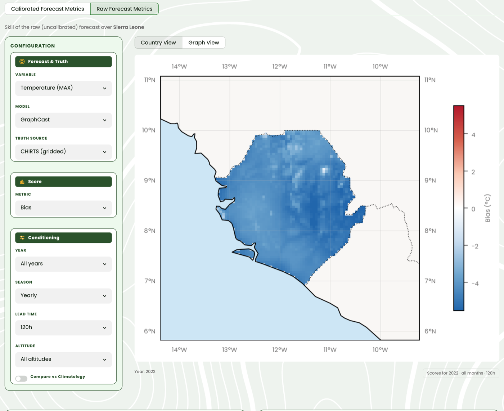

*Figure 10. Raw GraphCast Tmax bias against CHIRTS over Sierra Leone, day 5: about −4 °C over the whole country.*


*Figure 11. Error removed by calibration for GraphCast in Sierra Leone: about 3.7 °C against CHIRTS, 1.3 °C against ERA5.*

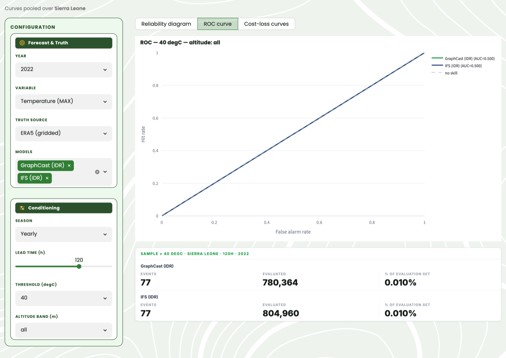

*Figure 12. Tmax > 40 °C against ERA5 in Sierra Leone, day 5: 77 events in 780,364 cell-days. The ROC curve is the diagonal (AUC 0.5). This is not a model failure; the truth dataset almost never contains the event.*

### 10.3 Rainfall track: side by side

Scores are given as the dashboard shows them (mm/hr) and in mm/day.

| Day 1, 2022 | Kenya GraphCast | Kenya IFS | Rwanda GraphCast | Rwanda IFS |
| --- | --- | --- | --- | --- |
| Raw MAE | 0.088 mm/hr (2.1 mm/day) | 0.093 mm/hr (2.2 mm/day) | 0.151 mm/hr (3.6 mm/day) | 0.151 mm/hr (3.6 mm/day) |
| Raw bias | −0.011 mm/hr (−0.3 mm/day) | −0.006 mm/hr (−0.1 mm/day) | +0.020 mm/hr (+0.5 mm/day) | +0.024 mm/hr (+0.6 mm/day) |
| Pattern correlation | 0.36 | 0.38 | 0.15 | 0.14 |
| Calibrated CRPS | **0.056 mm/hr** (1.3 mm/day) | 0.057 mm/hr (1.4 mm/day) | **0.091 mm/hr** (2.2 mm/day) | 0.092 mm/hr (2.2 mm/day) |
| AUC, rain > 1 mm/day | 0.84 | 0.83 | 0.79 | 0.78 |
| AUC, rain > 20 mm/day | 0.88 | 0.88 | 0.76 | 0.76 |
| Wet days (> 1 mm) | 14 % | 14 % | 36 % | 36 % |
| Heavy-rain days (> 20 mm) | 31,101 (1.7 %) | 31,101 (1.7 %) | 7,889 (2.6 %) | 7,889 (2.6 %) |

| Day 7, 2022 | Kenya GraphCast | Kenya IFS | Rwanda GraphCast | Rwanda IFS |
| --- | --- | --- | --- | --- |
| Raw MAE | 0.099 mm/hr (2.4 mm/day) | 0.103 mm/hr (2.5 mm/day) | 0.161 mm/hr (3.9 mm/day) | 0.158 mm/hr (3.8 mm/day) |
| Calibrated CRPS | 0.060 mm/hr (1.4 mm/day) | 0.061 mm/hr (1.5 mm/day) | 0.095 mm/hr (2.3 mm/day) | 0.096 mm/hr (2.3 mm/day) |
| AUC, rain > 20 mm/day | 0.88 | 0.87 | 0.73 | 0.74 |

| Day 1, 2024 | Kenya GraphCast | Kenya IFS | Rwanda GraphCast | Rwanda IFS |
| --- | --- | --- | --- | --- |
| Calibrated CRPS | 0.070 mm/hr (1.7 mm/day) | 0.071 mm/hr (1.7 mm/day) | 0.098 mm/hr (2.4 mm/day) | 0.100 mm/hr (2.4 mm/day) |
| AUC, rain > 20 mm/day | 0.92 | 0.90 | 0.79 | 0.77 |
| Wet days (> 1 mm) | 17 % | 17 % | 28 % | 28 % |
| Heavy-rain days (> 20 mm) | 54,527 (3.0 %) | 54,527 (3.0 %) | 11,551 (3.8 %) | 11,551 (3.8 %) |

*Event counts are cell-days. Here both models have forecasts on the same days and cells, so their counts are equal.*

### 10.4 Rainfall track: five findings

1. **On average the raw rainfall is about right, but it falls in the wrong places.** The national bias is small (−0.3 to +0.6 mm/day in 2022), yet the forecast map of a given day matches the observed map poorly: a pattern correlation of 0.36–0.38 in Kenya and only 0.14–0.15 in Rwanda, against 0.89 for Senegal's Tmax. Daily rainfall is much harder to place than daily temperature.

2. **Calibration still helps, for a different reason than in the Heat track.** There is almost no bias to remove, yet the calibrated CRPS is 0.8–1.1 mm/day below the raw MAE in Kenya and 1.4–2 mm/day in Rwanda (Figure R3). IDR turns one rain amount into a distribution with an honest chance of a dry day, and that is worth more than any single number.

3. **Kenya's forecasts can pick out heavy-rain days; Rwanda's much less.** For rain > 20 mm/day the AUC is 0.88 in Kenya and 0.73–0.76 in Rwanda, and it barely falls from day 1 to day 7. The probabilities are reliable but small (Figure R4): useful for ranking risk, not as a yes/no warning on their own.

4. **After calibration GraphCast and IFS are almost the same.** Their calibrated CRPS differ by at most 0.002 mm/hr and their AUC by at most 0.02 in every case above. Where you are, and which year, matters far more than which of the two models you pick.

5. **One year is not enough.** 2024 was wetter than 2022 in Kenya (17 % wet days against 14 %, and nearly twice as many heavy-rain days), and the heavy-rain AUC rose from 0.88 to 0.92. The difference between the two test years is larger than the difference between the two models. Errors also follow the seasons (Figures R1 and R2): quote a score with its year and season.

## 11. Before You Quote a Number

Every number in the dashboard is true *for a given truth product, year, area and sample*. Read this list once before you present a result.

| Watch out for | Example from this demo | What to do |
| --- | --- | --- |
| **The truth product changes the answer** | Senegal GraphCast Tmax bias, day 1: −3.2 °C against CHIRTS, −1.6 °C against ERA5. For Tmin the **sign flips**: −0.9 °C against CHIRTS, +0.5 °C against ERA5. | Always say which truth you used. Never mix the two in one comparison. |
| **ERA5 is a model, not an observation** | ERA5 is smoother and clips the extremes: it runs about 1.3 °C below CHIRTS in Senegal and about 2.7 °C below in Sierra Leone. | Agreeing with ERA5 means agreeing with another model's analysis. |
| **One test year** | All calibrated scores are for 2022 only. 2023 is missing from the bucket. | Present them as "one year of evidence", not as a climatology of skill. |
| **AUC flatters rare events** | Senegal, ERA5, 45 °C: only 901 events in the whole year. AUC stays near 0.95–0.99 while the value at day 7 falls to about 0.6. | Read the event count in the sample box first; read reliability and value for rare thresholds. |
| **Small areas, few cells** | The Dakar departments and Sierra Leone's Western Area Urban are only a few 0.05° cells. The Gambia sits inside Senegal's outline and is excluded from every pool. | Prefer the region or province view for small areas. |
| **Calibration narrows the gap between models** | Raw Tmax MAE at day 1: GraphCast 3.2 °C, IFS 3.4 °C. After IDR: 0.66 °C and 0.74 °C. | Rank models on calibrated scores if you plan to calibrate operationally; on raw scores if you will use the raw output. |
| **Tmin has no threshold curves** | Warm nights follow cloud cover more than heat. | Tmin is judged on MAE, bias, correlation and CRPS only. |
| **Rainfall: the dashboard is in mm/hr** | 0.056 mm/hr on a chart is 1.3 mm/day. | Multiply by 24 before you quote a dashboard value. Thresholds are already in mm/day. |
| **Rainfall: dry days dominate** | Kenya: 14–17 % of cell-days are wet; heavy-rain days are 1.7–3 %. | An "accurate" rainfall forecast may mostly be getting dry days right. Read the 1 mm and the heavy-rain thresholds separately. |
| **Rainfall: CHIRPS is not observed rain** | CHIRPS has no values over water (lakes and sea drop out), and its day runs 00–00 UTC, six hours off the forecasts' day. | Read your country page's *Known limits*; compare with national data when you have it (Demo 6). |

> #### The bridge to Demo 6
>
> **Heat track.** Figure 6 is the key result of this demo. The same GraphCast forecasts look like they have 2.5 °C of correctable error against CHIRTS, and 1 °C against ERA5. Before choosing a model, a team has to decide **which truth it trusts**, and ideally check both against its own stations.
>
> **Rainfall track.** Every rainfall number here is measured against one satellite product. If your service holds its own gauges, or a gridded product corrected with them, add it as in Section 4.2 and score the same forecasts against it: the bias, the CRPS and the heavy-rain AUC can all move.
>
> That is the ground truth challenge of [Demo 6](https://github.com/mesfind/ai_weather/blob/main/docs/_episodes/06-ground-truth-challenge.md).
{: .tip}

## Troubleshooting

| Symptom | Likely cause | What to do |
| --- | --- | --- |
| `python: command not found`, or `ModuleNotFoundError` | The command ran in the Spark's terminal, not inside ForecastCheck | Open `bash docker/run.sh shell` first, or prefix it with `bash docker/run.sh run` |
| *"no 'forecastcheck' image yet"* | The image is not built or loaded on this Spark | `bash docker/run.sh build` (or `load` your trainer's file) |
| *"Docker is not answering"*, or `Cannot connect to the Docker daemon` | Docker is not running in your account | `systemctl --user restart docker`, as in Demo 1 |
| *"port is already allocated"* or *"address already in use"* on `start` | Something else uses 8502 (another dashboard, or an SSH tunnel on this machine) | `PORT=8503 bash docker/run.sh start`, and tunnel 8503 instead |
| *"the data bucket needs a Google Cloud key"* | The key is not set in this terminal | `export GOOGLE_APPLICATION_CREDENTIALS=/etc/fleet-gcs-key.json` (Section 4.2) |
| *"cannot read gs://…"* when fetching | The key path is wrong, or cannot read the bucket | Check the path in the `export` line (Section 4.2) |
| *"no country selected"* | `.deployment` is missing | `echo senegal > .deployment` (or `sierra-leone`, `kenya`, `rwanda`) |
| *"… holds 2 truth products and none is configured"* | `--product` is missing (Heat track) | Add `--product chirts` or `--product era5` |
| *"unknown truth product …"* | A misspelt `--product` | Use one of the products the message lists (`chirps` for the Rainfall track) |
| A Heat-track run looks for `precipitation` files | `--variable` is missing | Add `--variable temperature_max` or `temperature_min` |
| Rainfall values look 24 times too small | The dashboard shows mm/hr | Multiply by 24 for mm/day (Section 6.2) |
| `SKIP — missing file` for IFS before 2018 | Expected: IFS starts in 2018 | Nothing |
| New results do not appear in the dashboard | The dashboard caches what it found at start-up | `bash docker/run.sh restart`, then refresh the browser |
| No altitude selector | `data/{country}/assets/dem.nc` is missing | Re-run the fetch; it prints a note when the DEM is absent |
| The dashboard does not open on the laptop | No port forward, or the dashboard is not running | Reconnect with `ssh -L 8502:localhost:8502 <user>@<spark>`; check `bash docker/run.sh status` |

## Exercises

Work in your country team. Exercises 1–3 run while the pipeline computes; Exercises 4–7 use the dashboard.

> #### Exercise 1: Read Before You Download (5 min)
>
> 1. Run `bash docker/run.sh fetch` again, **without** `--apply`. Why does it now find nothing to fetch? How many files did Section 3's fetch bring in (Section 4.2)?
> 2. Which lead times are in the bucket? Which one is not in the pipeline commands, and why might that be?
> 3. Open `config/verification.toml`. Write down your country's thresholds, seasons and altitude bands.
{: .exercise}

> #### Exercise 2: Predict, Then Measure (10 min)
>
> While the pipeline runs, write down your predictions, then compare them with the dashboard when it is done (National Overview, Raw Forecast Metrics).
>
> 1. Will MAE grow or shrink from day 1 to day 7? By roughly how much?
> 2. Will GraphCast or IFS have the lower MAE at day 1? At day 7?
> 3. Heat track: will the models be too warm or too cold for Tmax? For Tmin? Rainfall track: too wet or too dry, and will the national average hide it?
{: .exercise}

> #### Exercise 3: Why Not Train on 2022? (5 min, discussion)
>
> A colleague proposes training IDR on 2016–2022 and testing on 2022, "to use all the data".
>
> 1. What would happen to the CRPS of the calibrated forecast?
> 2. Why is that number misleading for next year's forecasts?
{: .exercise}

<details>
<summary><strong>Check your answer</strong></summary>
<br>

> #### Solution
>
> 1. The CRPS would drop, because IDR would be scored on days it was fitted to. With one fit per grid cell it can bend to the quirks of those exact days.
> 2. Next year's forecasts are days IDR has never seen. Only a test year kept out of training tells you how the calibrated forecast will behave in operations. The same rule appeared in Demo 4: calibrating and scoring on the same years overstates skill.
{: .solution}

</details>

> #### Exercise 4: Did Calibration Help? (15 min)
>
> Open **Score Decomposition**.
>
> 1. At day 1 (Tmax, or rainfall), how much did IDR reduce the error (CRPS of `-idr` vs. MAE of raw) for each model? Rainfall track: convert to mm/day.
> 2. Is the improvement the same at day 7? Explain using what IDR can and cannot fix.
> 3. Go back to the raw bias. Is the model with the largest bias the one that gained most from calibration?
{: .exercise}

> #### Exercise 5: Where and When (15 min)
>
> Use the region picker, the season filter and the altitude bands on National Overview.
>
> 1. Find the region, district or county where each model's MAE is highest. Is it coastal or inland, high or low?
> 2. In which season are the errors largest? Can you think of a physical reason? (Rainfall track: compare with Figures R1 and R2.)
> 3. Does the ranking of the two models change between regions or seasons?
{: .exercise}

> #### Exercise 6: A Warning (15 min)
>
> Open **Threshold Diagnostics** and pick the threshold your agency would use for a warning: a hot day (Heat track) or a heavy-rain day (Rainfall track).
>
> 1. Read the AUC for each model at day 1, 3, 5 and 7. When does it fall below 0.8?
> 2. On the reliability diagram, is the calibrated forecast over- or under-confident at high probabilities? Check the event count under the chart before answering.
> 3. On the cost-loss curve, for which range of users (cost-loss ratios) is the forecast worth acting on at day 3?
{: .exercise}

> #### Exercise 7: Same Forecast, Another Truth (10 min)
>
> **Heat track.** In Score Decomposition, select one model and compare it across **both** truth products (CHIRTS and ERA5).
>
> 1. How different are the MAE and the bias?
> 2. Which conclusion from Exercises 2–6 would change if you had only used ERA5?
>
> **Rainfall track.** If your trainer gave you national data (Section 4.2), select it next to CHIRPS and answer the same two questions. Otherwise, compare the two test years, 2022 and 2024: which conclusions hold in both?
>
> Everyone: write one question about the truth data that you want answered in Demo 6.
{: .exercise}

## Discussion Sheet on Metrics

Fill one sheet per team and share it at the end.

| Question | Our answer |
| --- | --- |
| Which model would we use at day 1? At day 5? | |
| Which metric convinced us most? Which one could have misled us? | |
| Where (region, season, altitude) is the forecast least reliable? | |
| At which lead time does the warning forecast (heat or heavy rain) stop being useful (AUC, value)? | |
| How large is the difference between truths (CHIRTS and ERA5, or CHIRPS and national data), or between test years, compared with the model errors? | |
| What would we need (data, stations, years) to trust these results operationally? | |

## Summary

> #### Key Points
>
> - A single forecast cannot tell you whether a model is trustworthy. Years of past forecasts scored against observations can.
> - ForecastCheck runs in three stages that communicate only through files: raw metrics, IDR calibration, calibrated metrics. The dashboard reads what they wrote.
> - IDR learns, per grid cell and lead time, how the observation is distributed given the forecast value. Train and test on different years.
> - CRPS equals MAE for a single-value forecast, so raw and calibrated forecasts can be compared on one axis.
> - Read AUC (discrimination), reliability (trust in the probability) and cost-loss value (worth acting on) together, and always with the event count.
> - Rainfall is harder to place than temperature, and most days are dry: read the wet-day and heavy-rain thresholds separately, and convert dashboard rainfall from mm/hr to mm/day.
> - Every number depends on the truth product, the year and the season. Say which ones you used.
{: .keypoints}
